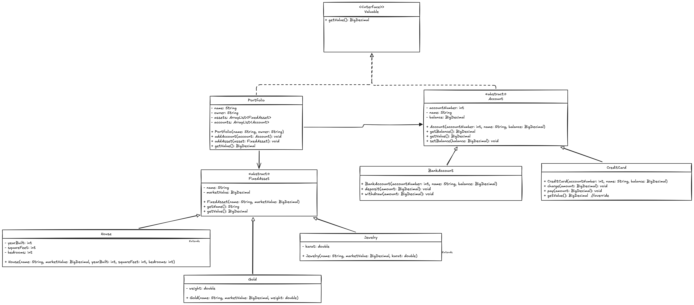

# Portfolio Manager

### Diagram

### Q&A
Did the deposit work for both accounts? Why or why not?

ans - no because account2 did not have access to the same methods that account1 has access to.

What methods are available for account1?

ans - the following are the methods that account1 has access to:

     BankAccount(int, String, BigDecimal): Void

     deposit(BigDecimal): Void

     withdraw(BigDecimal): Void

What methods are available for account2?

ans - the following are the methods that account2 has access to:

     getValue(BigDecimal): Abstract

Why?

because account2 and 1 are define from to separate classes